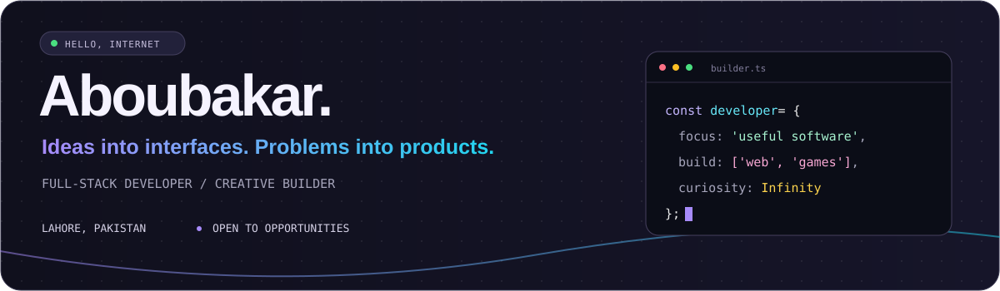
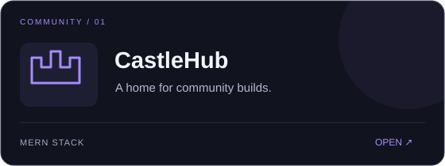
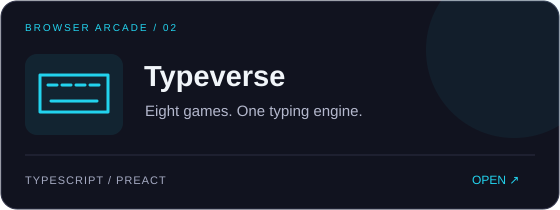
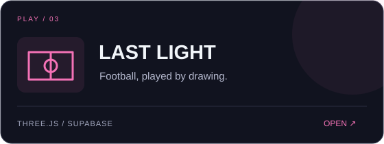
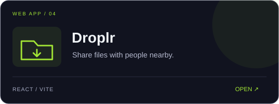
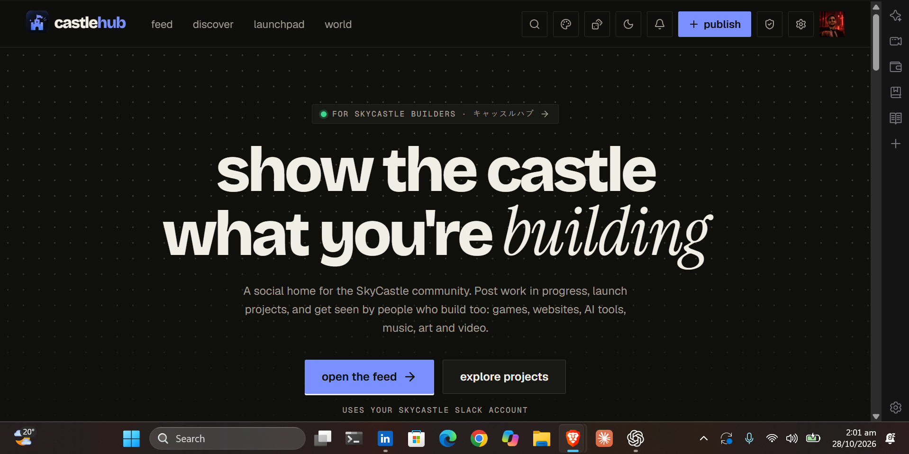
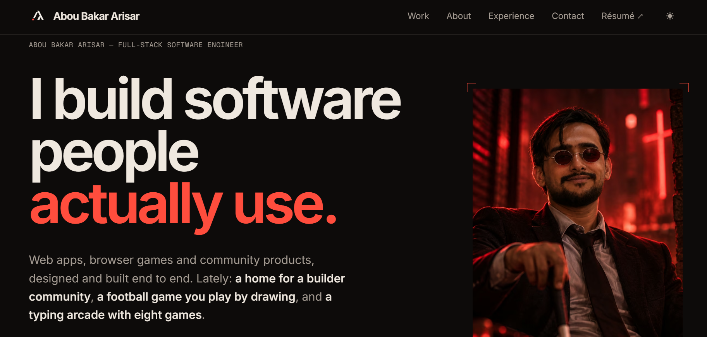

 

  

## A little about me

- 🛠️ Full-stack developer building with **React, Next.js, TypeScript, Node.js, and MongoDB**.
- 💡 I like finding everyday problems and making something useful out of them.
- 🎮 Outside conventional web apps, I build interactive browser games.
- 🌱 Exploring how AI can help me build better software.
- 📍 Based in **Lahore, Pakistan**, open to **remote and on-site roles**.

## Things I've built

<table>
<tr>
<td width="50%"></td>
<td width="50%"></td>
</tr>
<tr>
<td width="50%"></td>
<td width="50%"></td>
</tr>
</table>

<a href="https://aboubakarisar.tech"><strong>All projects ↗</strong></a> &nbsp; · &nbsp; <a href="https://github.com/AboubakarArisar/typeverse">Typeverse source</a> &nbsp; · &nbsp; <a href="https://github.com/AboubakarArisar/droplr-frontend">Droplr source</a>

<strong>📸 Open project screenshots and the story behind CastleHub</strong>

 
Good builds kept getting buried in our Slack community, so I made a home for them. CastleHub lets members share work in progress and discover community projects.

## My everyday toolkit

**Interfaces**

**Behind the scenes**

**Build, test, ship**

<strong>🧠 Other languages I've explored</strong>

 

My repositories include coursework, experiments, and practice alongside my product work.

## A peek at my GitHub

Language stats describe my public repositories, not my skill level.

---

### Got something interesting to build?

I'm open to frontend and full-stack opportunities. Let's talk.

**[Portfolio](https://aboubakarisar.tech) · [LinkedIn](https://www.linkedin.com/in/aboubakarisar/) · [aboubakar.dev@gmail.com](mailto:aboubakar.dev@gmail.com)**

Built with curiosity. Kept practical.

